<p align="center">
  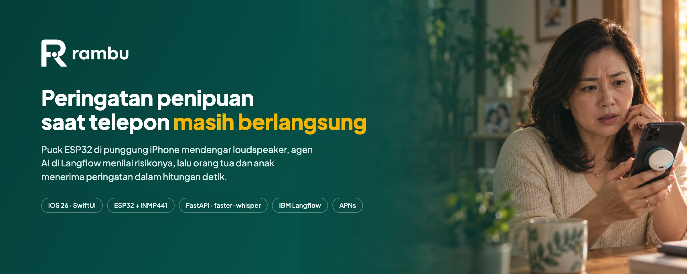
</p>

<p align="center">
  <a href="https://testflight.apple.com/join/rmzeZYaE"></a>
  
  
  
  
  
</p>

Rambu memperingatkan orang tua ketika telepon yang sedang mereka terima mengarah ke penipuan. Sebuah puck berbasis ESP32 yang ditempel di punggung iPhone mendengar suara loudspeaker, backend mentranskripsi audio per lima detik, agen AI di Langflow menilai risikonya, lalu orang tua dan anak menerima peringatan di HP masing-masing. Anak bisa langsung menjawab **Aman** atau **Penipuan**, dan jawaban itu sampai ke HP orang tua sebelum telepon ditutup.

Proyek ini dibuat untuk IBM SkillsBuild University Education National Hackathon 2026.

## Daftar isi

1. [Masalah](#masalah)
2. [Cara kerja](#cara-kerja)
3. [Arsitektur sistem](#arsitektur-sistem)
4. [Puck (IoT)](#puck-iot)
5. [Backend dan pipeline audio](#backend-dan-pipeline-audio)
6. [Agen AI di Langflow](#agen-ai-di-langflow)
7. [Aplikasi iPhone](#aplikasi-iphone)
8. [Privasi dan Responsible AI](#privasi-dan-responsible-ai)
9. [Status dan hasil uji](#status-dan-hasil-uji)
10. [Menjalankan Rambu](#menjalankan-rambu)
11. [Struktur repositori](#struktur-repositori)
12. [Keterbatasan dan rencana](#keterbatasan-dan-rencana)
13. [Tim](#tim)

## Masalah

Indonesia Anti-Scam Centre (IASC) mencatat 637.055 laporan penipuan sampai 31 Juli 2026, dan total kerugian yang dilaporkan mencapai Rp9,1 triliun per 14 Januari 2026. Banyak kasus terjadi lewat telepon: penelepon mengaku dari bank, kurir, atau aparat, lalu meminta kode OTP atau transfer saat korban masih panik di tengah percakapan.

Perlindungan yang ada bekerja sebelum atau sesudah percakapan. Caller ID memeriksa nomor sebelum telepon diangkat, sedangkan bank dan IASC baru bisa bertindak setelah uang terkirim. Selama percakapan berlangsung, tidak ada yang mendengar apa yang diminta penelepon. Rambu bekerja di rentang waktu itu.

iOS tidak mengizinkan aplikasi pihak ketiga mengakses audio panggilan seluler maupun WhatsApp. Karena itu Rambu memakai mikrofon terpisah di puck yang mendengar loudspeaker secara akustik, sama seperti orang yang duduk di sebelah orang tua.

## Cara kerja

| Peran | Perangkat | Yang dilakukan |
|---|---|---|
| Orang tua | iPhone + puck | Menerima telepon dengan loudspeaker. Mendapat peringatan dan jawaban anak. |
| Anak (pengawas) | iPhone sendiri | Mendapat peringatan beserta kalimat pemicu, lalu memutuskan Aman atau Penipuan. |

Alur satu panggilan, dari telepon berdering sampai jawaban anak:

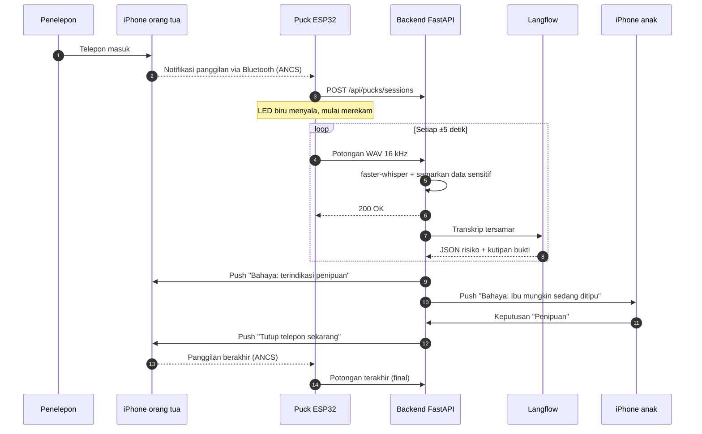

Puck mulai merekam lewat tiga jalan: notifikasi panggilan masuk dari iPhone (ANCS), sesi yang dibuat aplikasi saat CallKit melihat panggilan aktif (puck mengecek server tiap satu detik), atau tombol BOOT di papan ESP32. Rekaman berhenti saat iPhone melaporkan panggilan selesai, saat aplikasi meminta berhenti, atau setelah 30 detik tanpa suara.

## Arsitektur sistem

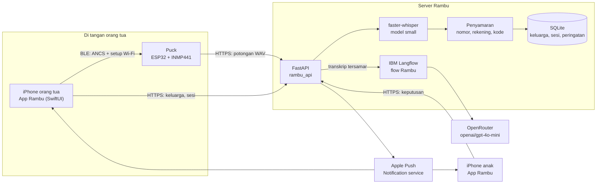

| Lapisan | Teknologi | Folder |
|---|---|---|
| Perangkat keras | ESP32 DevKit V1, mikrofon I²S INMP441, NimBLE, Arduino | [`hardware/`](hardware) |
| Aplikasi | SwiftUI, Swift 6, CallKit, ActivityKit, CoreBluetooth, String Catalog | [`ios/`](ios) |
| Backend | Python 3.12, FastAPI, faster-whisper, SQLite, APNs (HTTP/2 + JWT) | [`backend/`](backend) |
| Agen AI | IBM Langflow 1.12, GPT-4o-mini via OpenRouter, suhu 0 | [`langflow/`](langflow) |
| Deployment | Docker Compose dengan GPU NVIDIA, Cloudflare Tunnel | [`deploy/pilot/`](deploy/pilot), [`tools/`](tools) |

## Puck (IoT)

<p align="center">
  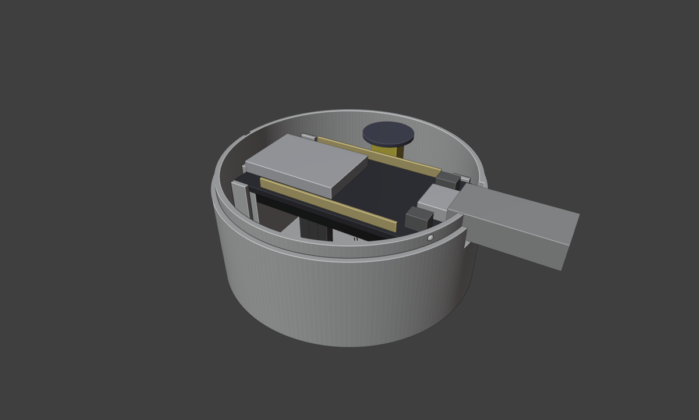
  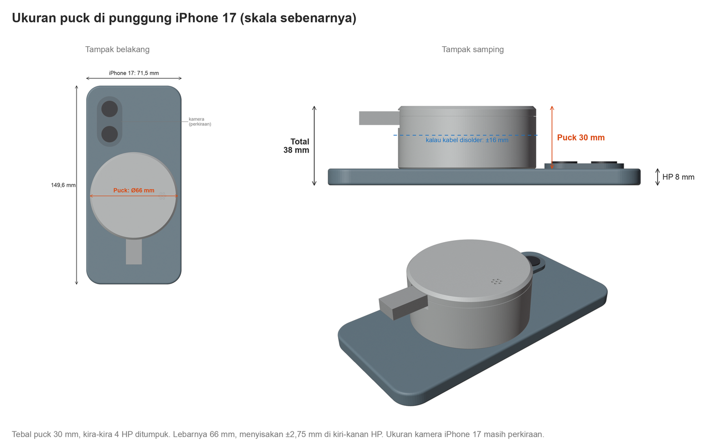
</p>

Puck versi 3 (24 Oktober 2026) memakai casing cetak 3D berdiameter 66 mm dan tebal 30 mm. Isinya papan ESP32 DevKit V1 30 pin dengan USB-C dan mikrofon INMP441 yang menghadap lubang grill di tutup. Daya diambil dari iPhone atau charger lewat kabel USB-C. File cetak dan sumber Blender casing ada di [`hardware/enclosure/`](hardware/enclosure).

### Komponen

| Komponen | Jumlah | Fungsi |
|---|---|---|
| ESP32 DevKit V1, 30 pin, USB-C | 1 | Bluetooth LE ke iPhone, Wi-Fi ke server, encoding audio |
| Mikrofon I²S INMP441 | 1 | Menangkap suara loudspeaker iPhone |
| Kabel jumper female-female 10 cm | 6 | Sambungan mikrofon ke ESP32 |
| Casing badan + tutup | 1 set | PETG atau PLA+ putih, layer 0,2 mm, infill 20%, tanpa support |

### Sambungan pin

Sesuai konstanta di [`puck-firmware.ino`](hardware/puck-firmware/puck-firmware.ino):

| INMP441 | ESP32 | Konstanta firmware |
|---|---|---|
| SCK | D32 | `MIC_SCK = 32` |
| WS | D25 | `MIC_WS = 25` |
| SD | D33 | `MIC_SD = 33` |
| L/R | GND | kanal kiri |
| VDD | 3V3 | |
| GND | GND | |

LED biru bawaan (GPIO 2) menyala selama puck merekam. Tombol BOOT (GPIO 0) memulai atau menghentikan rekaman secara manual.

### Cara firmware bekerja

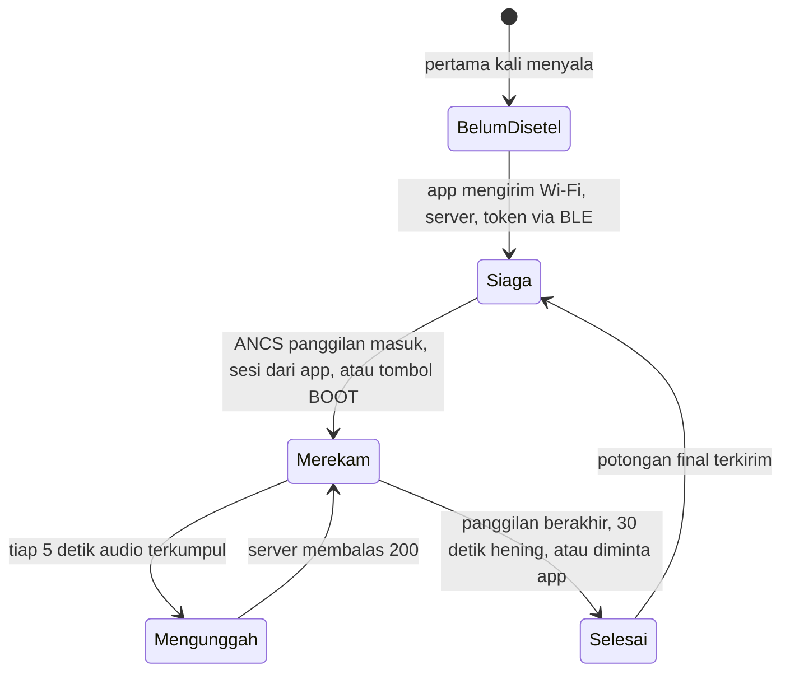

- **Bluetooth.** Puck tampil sebagai `Rambu Puck` dan meminta pairing terenkripsi dengan bonding. Setelah iPhone tersambung, puck berlangganan Apple Notification Center Service (ANCS) dan hanya bereaksi pada kategori panggilan masuk, panggilan aktif, dan panggilan tak terjawab. Isi notifikasi lain diabaikan.
- **Setup dari aplikasi.** Satu karakteristik GATT menerima nama Wi-Fi, kata sandi, alamat server, dan token keluarga dari tab Puck, lalu menyimpannya di flash (NVS). Status `connecting`, `connected`, atau `failed` dikirim balik ke aplikasi lewat notifikasi BLE. Firmware yang sama dipakai untuk semua keluarga.
- **Audio.** Mikrofon dibaca pada 16 kHz 32-bit, diturunkan ke 8 kHz, lalu dikompres IMA ADPCM 4-bit ke slot berdurasi satu detik. Buffer menampung sampai 16 detik, jadi suara tidak hilang saat jaringan lambat. Saat diunggah, audio didekode kembali menjadi WAV PCM 16-bit mono 16 kHz.
- **Unggahan.** Tiap lima slot dikirim sebagai satu potongan ke `POST /api/pucks/sessions/{id}/chunks` dengan header `X-Rambu-Sequence` dan `X-Rambu-Final`, lewat koneksi HTTPS keep-alive dan token Bearer. Permintaan yang gagal dicoba ulang sampai tiga kali.

| UUID | Jenis | Isi |
|---|---|---|
| `5B4F74AF-95E4-4449-8129-C97AD2293807` | Layanan | Layanan puck Rambu |
| `29308BE3-4FCA-47FB-AF2D-3539D416BAA1` | Karakteristik, baca terenkripsi | Penanda pairing |
| `8E1F2A6C-3B7D-4C59-9A0E-5D2F7B4C1E93` | Karakteristik, tulis terenkripsi + notify | Setup Wi-Fi dan status koneksi |
| `7905F431-B5CE-4E99-A40F-4B1E122D00D0` | Layanan Apple (puck sebagai klien) | ANCS di iPhone |

### Rencana ukuran puck

Puck sekarang setebal kira-kira empat iPhone yang ditumpuk dan masih berkabel. Uji pengguna meminta puck yang jauh lebih tipis. Ukuran empat opsi berikut sudah dihitung, tetapi prototipenya belum dibuat.

<p align="center">
  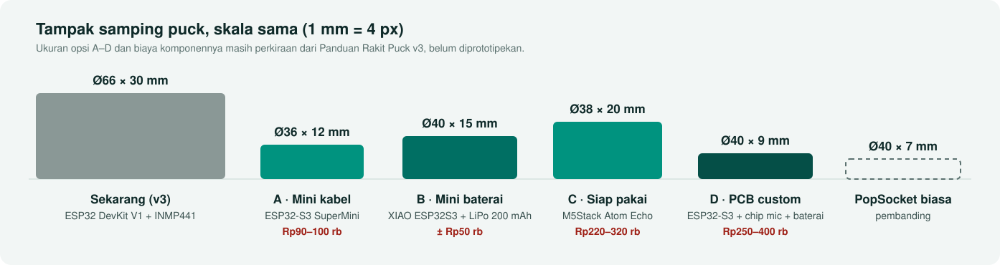
</p>

| Opsi | Komponen | Ukuran | Kelebihan | Kekurangan |
|---|---|---|---|---|
| A. Mini kabel | ESP32-S3 SuperMini + INMP441 | Ø36 × 12 mm | Paling murah, mikrofon tetap sama | Perlu solder, masih berkabel |
| B. Mini baterai | XIAO ESP32S3 + INMP441 + LiPo 200 mAh | Ø40 × 15 mm | Tanpa kabel, selebar PopSocket | Baterai sekitar 1,5–2 jam streaming |
| C. Siap pakai | M5Stack Atom Echo | Ø38 × 20 mm | Tanpa solder, ada speaker untuk bunyi peringatan | Paling tebal di antara opsi mini |
| D. PCB custom | Modul ESP32-S3 + chip mic + baterai tipis | ±Ø40 × 9 mm | Paling dekat dengan PopSocket (Ø40 × 7 mm) | Perlu desain PCB sendiri |

Arah kami: opsi B untuk pilot berikutnya karena kabelnya hilang, lalu opsi D untuk produk. Motor getar ikut masuk di kedua opsi itu, karena lampu di punggung HP tidak terlihat oleh orang tua yang sedang menempelkan HP ke telinga.

## Backend dan pipeline audio

Backend ada di [`backend/rambu_api`](backend/rambu_api). Setiap potongan audio melewati langkah berikut:

1. **Validasi.** Content-Type harus `audio/wav`, ukuran maksimal 1 MB, dan nomor urut harus berlanjut. Potongan yang terkirim dua kali dikenali dari hash SHA-256 dan tidak diproses ulang.
2. **Transkripsi.** faster-whisper (model `small`, CPU int8 di Mac atau CUDA float16 di server GPU) memakai bahasa sesi, `id` atau `en`. Audio ditulis ke file sementara yang langsung dihapus setelah ditranskripsi.
3. **Penyamaran.** [`redaction.py`](backend/rambu_api/redaction.py) mengganti nomor telepon, nomor rekening (angka maupun yang diucapkan), dan kode OTP dengan `[NOMOR_TELEPON]`, `[NOMOR_REKENING]`, dan `[KODE]`. Hanya teks tersamar yang disimpan dan masuk log.
4. **Balasan cepat ke puck.** Puck langsung menerima `200 OK`, jadi bisa mengirim potongan berikutnya tanpa menunggu AI.
5. **Analisis di latar belakang.** Transkrip tersamar seluruh panggilan dikirim ke Langflow. Hasilnya divalidasi (lihat bagian berikutnya) lalu disimpan.
6. **Notifikasi.** Jika risiko naik, backend mengirim push APNs berbunyi mendesak ke orang tua dan peringatan ke setiap pengawas di keluarga itu, masing-masing dalam bahasa perangkatnya.

Keputusan anak memakai aturan jawaban pertama yang berlaku. SQLite menjalankan transaksi `IMMEDIATE`, sehingga kalau dua pengawas menekan tombol hampir bersamaan, hanya satu yang tersimpan. Yang kalah cepat menerima `409` beserta keputusan yang sudah ada.

### Endpoint utama

| Endpoint | Pemanggil | Fungsi |
|---|---|---|
| `POST /api/pilot/families` | App orang tua | Membuat keluarga dan kode undangan enam digit |
| `POST /api/pilot/families/join` | App anak | Bergabung dengan kode undangan |
| `POST /api/pilot/pucks` | App orang tua | Mendaftarkan puck dan menerbitkan token puck |
| `PUT /api/pilot/push-token` | App | Menyimpan token APNs dan bahasa perangkat |
| `POST /api/pucks/sessions` | Puck | Membuka sesi saat telepon berdering |
| `GET /api/pucks/sessions/active` | Puck | Mengambil sesi yang dibuka app |
| `POST /api/pucks/sessions/{id}/chunks` | Puck | Mengunggah potongan WAV |
| `POST /api/protection/sessions` | App orang tua | Membuka sesi dari CallKit |
| `GET /api/pilot/alerts`, `GET /api/pilot/history` | App | Peringatan aktif dan riwayat bersama keluarga |
| `POST /api/pilot/alerts/{id}/decision` | App anak | Mengirim keputusan Aman atau Penipuan |
| `GET /health` | Monitoring | Pemeriksaan kesehatan layanan |

## Agen AI di Langflow

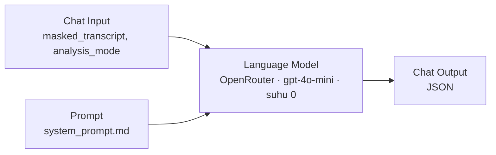

Flow `Rambu` ([`langflow/flows/Rambu.json`](langflow/flows/Rambu.json)) dihasilkan dari kode oleh [`build_flow.py`](langflow/scripts/build_flow.py) dan dipasang otomatis oleh [`bootstrap_flow.py`](langflow/scripts/bootstrap_flow.py). Prompt sistemnya ada di [`system_prompt.md`](langflow/prompts/system_prompt.md). Model menerima transkrip yang sudah disamarkan dan mode `live` (panggilan masih berjalan) atau `final`.

Model wajib membalas dengan satu objek JSON:

```json
{
  "risk_level": "high_risk",
  "signals": ["impersonation", "secret_code"],
  "evidence": [
    { "quote": "saya petugas keamanan bank", "signals": ["impersonation"] },
    { "quote": "Sebutkan kode OTP enam digit", "signals": ["secret_code"] }
  ],
  "explanation": "Penelepon mengaku dari bank dan meminta kode OTP.",
  "recommended_action": "Tutup telepon dan hubungi bank lewat nomor resmi."
}
```

Ada lima sinyal: `impersonation` (menyamar sebagai institusi), `urgency` (tekanan waktu), `secret_code` (meminta OTP, PIN, atau kata sandi), `transfer`, dan `remote_app` (meminta memasang aplikasi atau membuka tautan).

Jawaban model tidak langsung dipakai. [`langflow_client.py`](backend/rambu_api/langflow_client.py) dan [`models.py`](backend/rambu_api/models.py) memeriksanya dulu:

- **Bukti harus kutipan asli.** Setiap `quote` harus ada persis di transkrip. Kutipan karangan model membuat jawaban ditolak.
- **Sinyal harus didukung bukti.** Daftar `signals` harus sama dengan gabungan sinyal di `evidence`, dan risiko `low` tidak boleh punya sinyal.
- **Pengaman permintaan kode.** Pola dwibahasa mendeteksi permintaan aktif seperti "sebutkan kode OTP" atau "read me the PIN". Kalau pola ini cocok, sinyal `secret_code` tetap ditambahkan walaupun model melewatkannya.
- **Ragu berarti waspada.** Hasil `needs_review` dinaikkan menjadi `high_risk`, sehingga setiap panggilan berisiko tampil sebagai Bahaya.
- **Kegagalan tidak disembunyikan.** Jawaban yang melanggar format dicoba ulang sekali. Kalau tetap gagal, sesi ditandai error dan aplikasi menampilkannya tanpa hasil pengganti.

IBM Bob dipakai sebagai asisten pengembangan. Berkas [`.bobignore`](.bobignore) mengatur file yang tidak dibaca Bob.

## Aplikasi iPhone

<p align="center">
  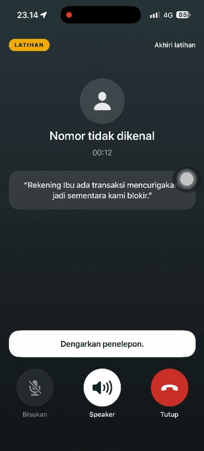
  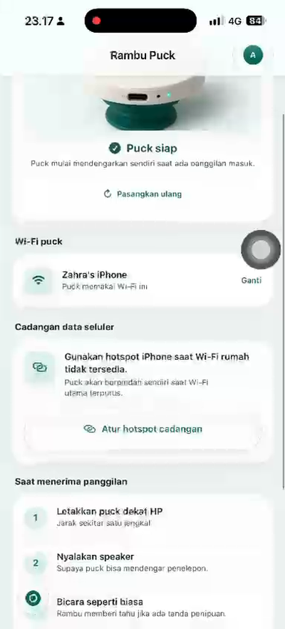
  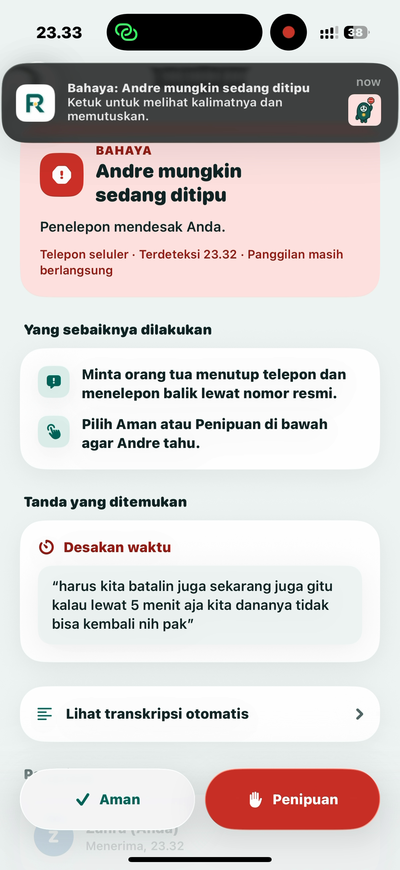
  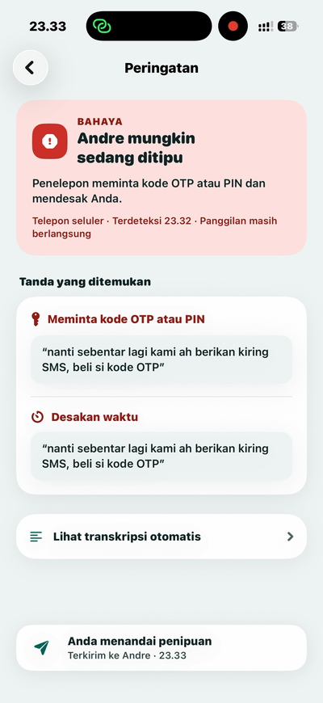
  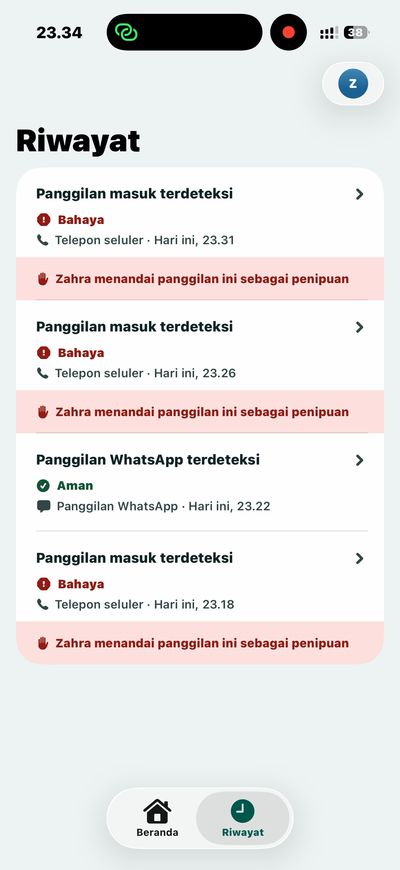
</p>
<p align="center"><sub>Rekaman layar dari uji nyata 30 Oktober 2026: latihan telepon · puck siap · peringatan di HP anak · keputusan terkirim · riwayat keluarga</sub></p>

Satu aplikasi melayani dua peran. Orang tua menyiapkan keluarga, sedangkan anak bergabung dengan kode enam digit dari orang tua.

| Fitur | Keterangan |
|---|---|
| Latihan telepon | Saat onboarding, orang tua mencoba telepon tiruan dan melihat peringatan sebelum menerima telepon asli. |
| Pairing puck | Tab Puck mencari puck lewat Bluetooth, memasangkannya, lalu mengirim Wi-Fi dan alamat server. |
| Peringatan mendesak | Push dengan suara khusus (`rambu-urgent.caf`), banner di dalam aplikasi, dan Live Activity di Dynamic Island. |
| Keputusan anak | Anak melihat kalimat penelepon yang memicu peringatan, lalu menekan Aman atau Penipuan. Jawaban pertama mengunci tombol pengawas lain. |
| Riwayat bersama | Semua anggota keluarga melihat panggilan berisiko, kalimat pemicu, dan siapa yang memutuskan. |
| Dua bahasa | Indonesia dan Inggris, termasuk transkripsi, analisis, dan push per perangkat. |

Kode aplikasi dipisah dari backend lewat tiga protokol di [`Services.swift`](ios/RambuPuck/Services/Services.swift): `CallAnalysisSource`, `FamilyRelay`, dan `PuckLink`. Detail aplikasi ada di [`ios/README.md`](ios/README.md).

## Privasi dan Responsible AI

- **Persetujuan di awal.** Onboarding meminta persetujuan orang tua sebelum keluarga dihubungkan.
- **Audio mentah tidak disimpan.** Potongan WAV hanya ada selama transkripsi, lalu file sementaranya dihapus.
- **Data sensitif disamarkan sebelum ke AI.** Nomor telepon, rekening, dan kode tidak pernah dikirim ke Langflow atau model.
- **AI menunjukkan alasannya.** Setiap peringatan membawa kutipan persis dari transkrip, jadi anak bisa mengecek sendiri.
- **Manusia yang memutuskan.** Rambu tidak pernah menyatakan seseorang pasti penipu. Keputusan akhir ada pada anak dan orang tua.
- **Anak hanya melihat yang perlu.** Panggilan Aman tidak dikirim ke pengawas, dan pengawas hanya menerima kalimat yang memicu peringatan.

## Status dan hasil uji

Per 31 Oktober 2026, alur dari puck sampai keputusan anak sudah berjalan di iPhone sungguhan.

**Uji telepon nyata, 30 Oktober 2026.** Seorang ayah berusia 40 tahun menerima telepon penipuan tiruan dengan puck di dekat iPhone-nya, sementara anaknya memegang iPhone pengawas.

| Kejadian | Hasil |
|---|---|
| Peringatan muncul | Sekitar 5 detik setelah penelepon mulai memancing kode, 3 detik sebelum ia meminta kode dibacakan |
| Anak menekan Penipuan | 11 detik setelah peringatan |
| Jawaban sampai di HP orang tua | Kurang dari 12 detik sejak peringatan muncul |
| Kode OTP | Tidak pernah disebutkan |

**Tes otomatis.** Backend dan Langflow: 200 tes lulus, 4 dilewati (commit `2778bcb`). Aplikasi iOS memakai Swift Testing di [`ios/RambuPuckTests`](ios/RambuPuckTests), dan firmware punya tes unit untuk logika langganan ANCS.

**Dataset suara.** [`samples/datasets/rambu-voice-v0.1`](samples/datasets/rambu-voice-v0.1) berisi 38 percakapan sintetis berbahasa Indonesia (8 aman, 30 penipuan). Evaluasi akurasi pada 14 rekaman held-out belum dijalankan. Perintahnya ada di [`TESTING.md`](TESTING.md).

## Menjalankan Rambu

### Coba aplikasinya

Aplikasi tersedia di [TestFlight](https://testflight.apple.com/join/rmzeZYaE). Deteksi telepon butuh puck dan server Rambu yang menyala, sedangkan server pilot saat ini belum aktif 24 jam. Tanpa puck, yang bisa dicoba adalah onboarding, latihan telepon, dan pembuatan keluarga.

### Menjalankan seluruh sistem

```
iPhone call ──BLE──▶ ESP32 puck ──Wi-Fi──▶ alamat HTTPS publik ──tunnel──▶ backend di Mac ──▶ Langflow
```

Yang dibutuhkan:

- Mac dengan Xcode 26, XcodeGen, Python 3.12, `uv`, `cloudflared`, `arduino-cli`
- iPhone dengan iOS 26 (iPhone kedua untuk pengawas)
- Puck: ESP32 DevKit V1, mikrofon INMP441, 6 kabel jumper female-female
- API key OpenRouter, Apple push key (`.p8`), token Cloudflare Tunnel

**1. Langflow**

```bash
uv venv langflow/.venv --python 3.12 && source langflow/.venv/bin/activate
uv pip install 'langflow>=1.12,<1.13'        # hanya pertama kali
langflow run --host 127.0.0.1 --port 7861
```

Buat API key di <http://127.0.0.1:7861> → **Settings → Langflow API Keys**.

**2. Backend**

```bash
cp backend/.env.example backend/.env          # lalu isi LANGFLOW_*, OPENROUTER_API_KEY, APNS_*
uv sync --project backend
uv run --project backend python langflow/scripts/bootstrap_flow.py   # mencetak "Langflow flow ready: Rambu"
uv run --project backend uvicorn rambu_api.app:app --host 0.0.0.0 --port 8001 --env-file backend/.env
```

Aplikasi yang dijalankan dari Xcode memakai push sandbox, jadi isi `APNS_ENVIRONMENT=sandbox` dengan key sandbox. Build TestFlight membutuhkan `production`.

**3. Alamat publik**

Aplikasi dan puck berkomunikasi dengan satu alamat HTTPS publik yang diatur di `RambuServer.url` ([`PilotAPI.swift`](ios/RambuPuck/Services/PilotAPI.swift)). Puck menerima alamat ini dari aplikasi. Arahkan rute Cloudflare Tunnel untuk hostname itu ke `http://localhost:8001`.

```bash
cloudflared tunnel run --token-file ~/.config/rambu/cloudflare-tunnel-token
```

Untuk server GPU, [`deploy/pilot/compose.yaml`](deploy/pilot/compose.yaml) menjalankan backend dan Langflow di Docker dengan faster-whisper di CUDA.

**4. Aplikasi iPhone**

```bash
cd ios && xcodegen generate && open RambuPuck.xcodeproj
```

Jalankan di iPhone, isi nama orang tua, dan selesaikan latihan telepon. Ketuk **Hubungkan keluarga** di beranda untuk membuat keluarga. Pengawas bergabung dengan kode enam digit.

Bahasa mengikuti pengaturan iPhone (Indonesia atau Inggris) dan bisa diganti di **Profil → Bahasa** tanpa menghapus keluarga atau riwayat. Terjemahan dikelola di [`Localizable.xcstrings`](ios/RambuPuck/Resources/Localizable.xcstrings).

**5. Puck**

Sambungkan kabel sesuai [tabel pin](#sambungan-pin), lalu flash firmware sekali (tidak ada yang perlu diubah):

```bash
arduino-cli core install esp32:esp32
arduino-cli lib install ArduinoJson NimBLE-Arduino@2.2.3
arduino-cli compile --fqbn esp32:esp32:esp32:PartitionScheme=huge_app hardware/puck-firmware
arduino-cli upload  --fqbn esp32:esp32:esp32:PartitionScheme=huge_app -p /dev/cu.usbserial-0001 hardware/puck-firmware
```

Nyalakan puck dari iPhone atau charger. Di aplikasi buka tab **Puck** → **Pasangkan puck** → **Pair**, izinkan notifikasi, lalu isi Wi-Fi di **Wi-Fi puck**. Aplikasi mengirim Wi-Fi, alamat server, dan token keluarga ke puck lewat Bluetooth.

**6. Uji**

Tutup Rambu, telepon iPhone tersebut, angkat dengan loudspeaker, lalu ucapkan kalimat yang mirip penipuan. LED biru puck menyala selama merekam, peringatan masuk dalam 5–10 detik, dan puck berhenti saat telepon ditutup. Panggilan muncul di **Riwayat**.

Log puck bisa dilihat dengan menyambungkannya ke Mac:

```bash
arduino-cli monitor -p /dev/cu.usbserial-0001 -c baudrate=115200
```

Skenario uji manual dan evaluasi dataset dijelaskan di [`TESTING.md`](TESTING.md).

## Struktur repositori

```
rambu/
├── backend/            FastAPI: sesi proteksi, transkripsi, penyamaran, keluarga, APNs
│   ├── rambu_api/
│   └── tests/          pytest
├── hardware/
│   ├── puck-firmware/  firmware ESP32 (Arduino, NimBLE, I²S, ADPCM)
│   └── enclosure/      casing cetak 3D: STL badan dan tutup, sumber Blender (puck.py)
├── ios/                aplikasi SwiftUI, widget Live Activity, tes
├── langflow/           flow Rambu, prompt sistem, skrip build dan bootstrap
├── deploy/pilot/       Docker Compose untuk server GPU
├── samples/            skrip uji dan dataset suara rambu-voice-v0.1
├── tools/              evaluasi dataset, perekam uji telepon, skrip server
├── assets/readme/        gambar untuk README
└── TESTING.md          panduan uji otomatis dan uji telepon nyata
```

## Keterbatasan dan rencana

| Keterbatasan sekarang | Rencana |
|---|---|
| Backend berjalan di Mac tim lewat Cloudflare Tunnel dan belum aktif 24 jam. | Pindah ke server cloud memakai konfigurasi Docker Compose yang sudah ada. |
| Puck Ø66 × 30 mm, berkabel, dan hanya punya LED yang tidak terlihat orang tua. | Puck baterai (opsi B) lalu PCB custom (opsi D), keduanya dengan motor getar. |
| iOS tidak mengizinkan aplikasi memutus telepon. | Kalimat peringatan dibuat lebih tegas dan langsung menyuruh menutup telepon. |
| Akurasi pada dataset belum diukur. | Menjalankan evaluasi 14 rekaman held-out dan mempublikasikan hasilnya. |
| Belum ada jalur cadangan kalau anak tidak merespons. | Eskalasi ke pengawas lain dan saran otomatis setelah batas waktu. |
| Puck belum memverifikasi sertifikat TLS server (`setInsecure`). | Menyematkan sertifikat root server di firmware. |
| Uji pengguna: onboarding harus selesai sampai puck tersambung, pairing perlu lebih mudah. | Onboarding satu alur sampai puck online, pairing lewat QR. |
| Model analisis memakai GPT-4o-mini. | Menguji IBM Granite di watsonx.ai sebagai model analisis. |

## Tim

| Nama | Peran |
|---|---|
| Richard | Product manager, desain dan frontend iOS, desain casing puck |
| Sfatimah Azzahra | Backend, agen AI Langflow, firmware puck, integrasi |
